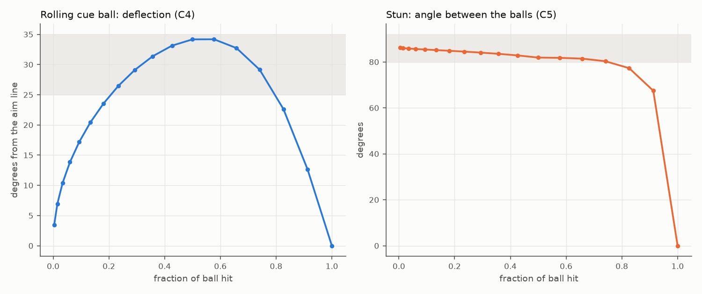
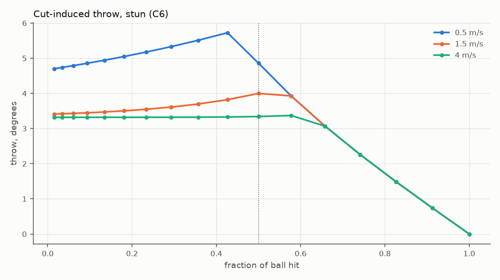
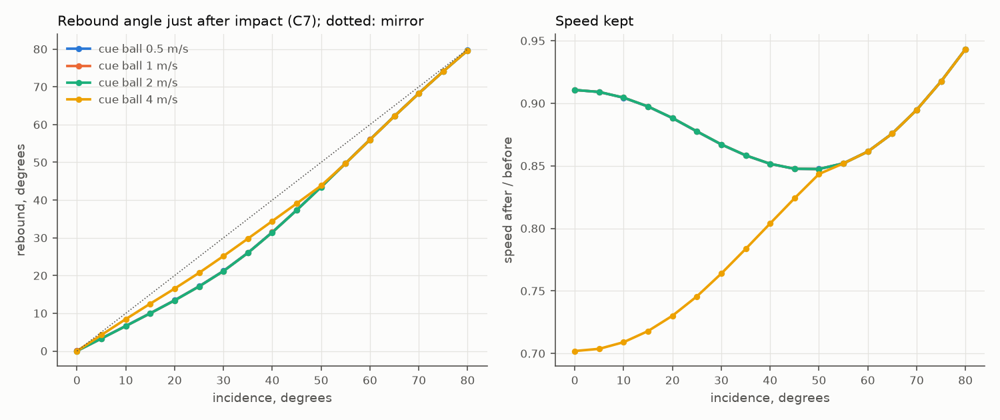
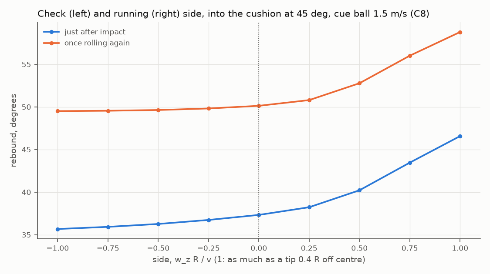
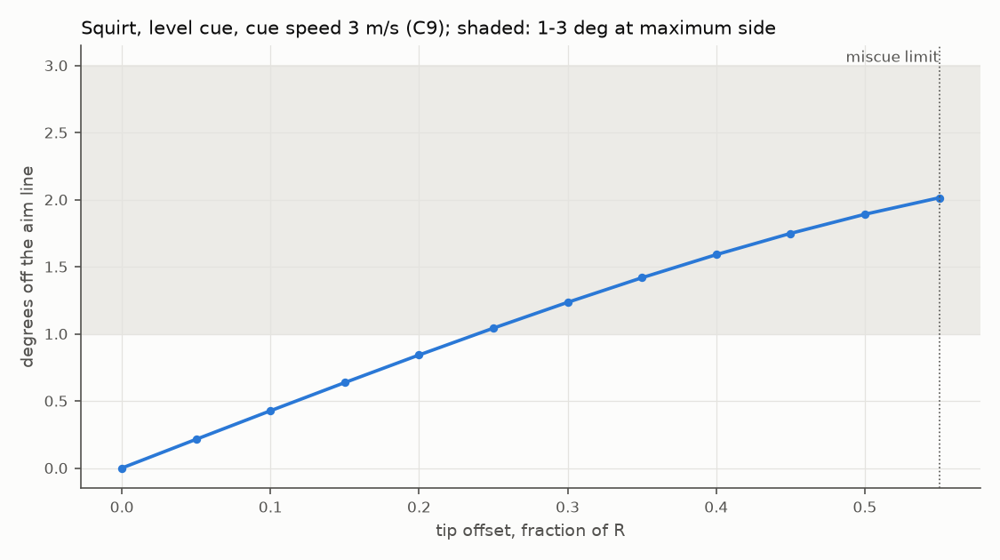
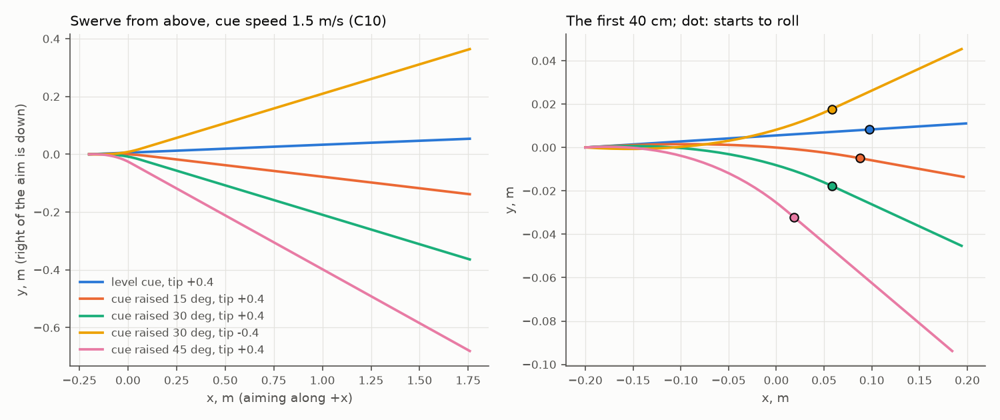
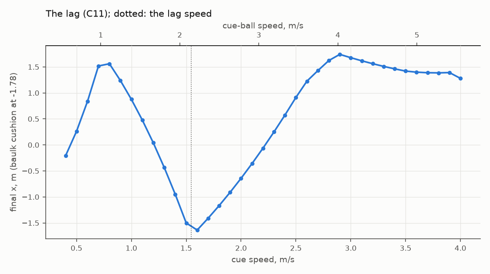
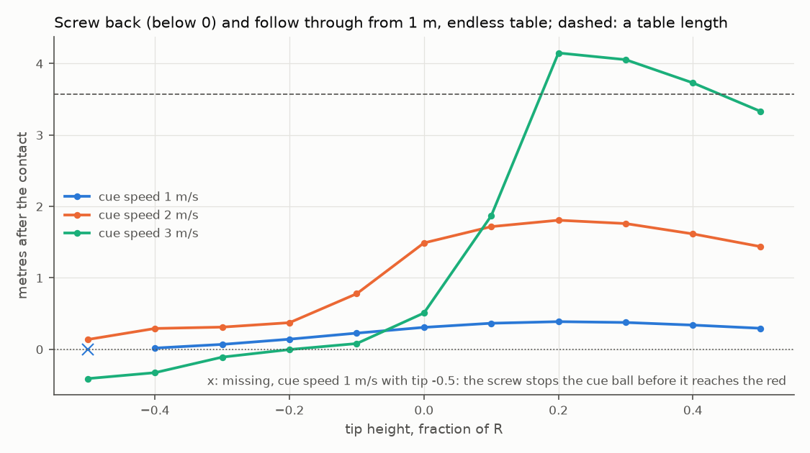
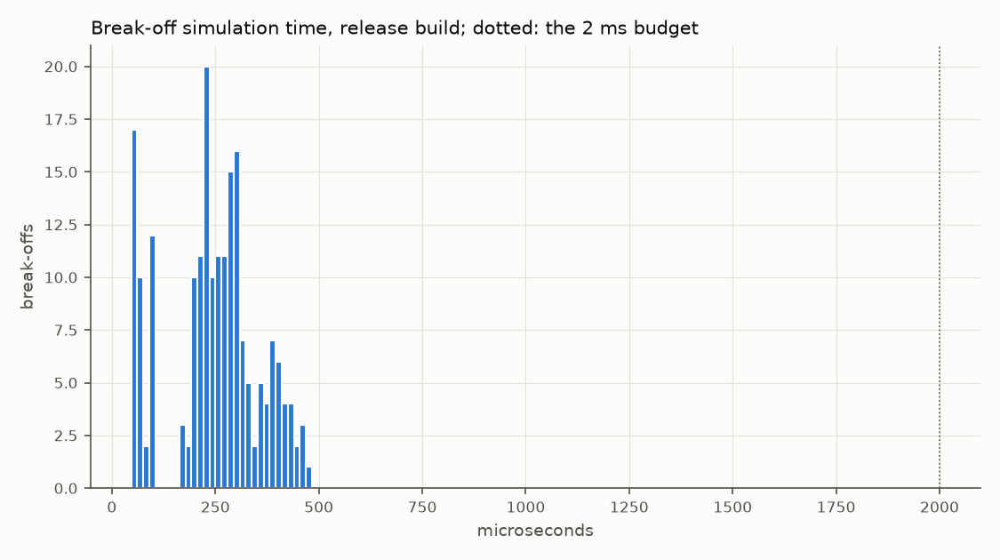

# Calibration report

Physics parameters `1b74109f2b0ff078`, table outline `cf92efd6db3fff39`, core 0.1.0, release build, from `calibration-data`.

## In plain words

Pace below is the cue ball's speed as it leaves the tip. A gentle push is about 1 m/s, a medium pace
about 2 m/s, a firm shot 3-4 m/s, a power shot 5 m/s and up.

- **Stun.** A full-ball stun leaves the cue ball almost dead: it keeps 3% of its speed and creeps on
  about 1 cm from a 2 m/s contact. From 50 cm, striking a third of the way down at 2.4 m/s stops
  the cue ball within 4 cm; from further away you need more screw or more pace, because the cloth
  rubs the backspin off on the way.
- **Screw needs pace.** The cloth takes spin off quickly (it grips like the measured snooker cloth
  its value comes from). Maximum screw from 50 cm comes back about 12 cm at 1.9 m/s, 1.8 m at
  2.8 m/s and 4.6 m at 3.7 m/s. From 1 m, 2.8 m/s screws back 40 cm and 3.7 m/s 2.8 m; at 1.9 m/s
  the screw is gone by the time it arrives and the cue ball runs on 14 cm. A centre-ball hit from
  close range is a stun-run-through (25 cm from 50 cm at 2.8 m/s).
- **Follow.** A rolling cue ball follows through at about 2/7 of its speed: from 1 m at 1.9-2.8 m/s,
  hitting above centre follows 1.4-1.8 m; at 3.5 m/s about 4 m.
- **Cut angles.** Rolling cue balls come off a quarter- to three-quarter-ball cut 29-34 degrees from
  the aim line (the 30-degree rule). Stunned, the two balls part at 80-84 degrees, a little under
  90 because snooker balls are not perfectly elastic.
- **Throw.** On a half-ball cut the friction between the balls drags the object ball off the line
  by 4.9 degrees at 0.45 m/s, 4.2 at 1.3 m/s and 3.4 at 3.1 m/s: a slow cut pot over 1 m lands
  about 8 cm thinner than the contact line says, a firm one about 6 cm. Follow or screw roughly
  halves it.
- **Side and squirt.** Maximum side (just short of a miscue) pushes the cue ball 2.0 degrees off
  the aim line, about 3.5 cm over 1 m, away from the side used. Raising the butt with side swerves
  the ball back towards the side once it grips: with the cue raised 30 degrees and 40% side it
  turns about 13 degrees.
- **Cushions.** A rolling ball straight into a cushion comes back with 91% of its speed at normal
  pace; firm hits lose more, 77% at 3.5 m/s (80% was measured on a snooker table). Running
  side opens the angle off the cushion (into the cushion at 45 degrees: 47 degrees out with running
  side, 37 with none) and check side closes it (36).
- **Cloth speed.** A lag (baulk line to the top cushion and back to the baulk cushion) needs the
  cue ball to leave at 2.1 m/s, and its last length takes 8.4 seconds. A ball rolling at 1 m/s runs
  about 5 m before it stops.
- **Still starting guesses, for you to judge by feel in M2:** how lively the pocket jaws are
  (firm balls rattling, slow ones dropping), the nap drift on slow balls with and against the nap,
  what a miscue does, how much a very hard ball dies on a cushion, and the cloth's overall pace
  (the one snooker measurement found plays slower than this; tournament tables are heated and
  faster, so this sits between the two).

## Results against the targets

Every target C1-C11 passes in the calibration suite (`ofs_calibration_tests`) with these values.

| # | What | Measured | Target |
| --- | --- | --- | --- |
| C1 | Centre-ball, no spin: slides then rolls | at 2 m/s rolls after 0.47 m at 1.43 m/s, matching the formula to 1e-6 | 12 v^2 / (49 mu_s g), 5/7 v (TP 4.1) |
| C2 | Full-ball stun | cue ball keeps 3.0% of its speed ((1-e)/2) | stops dead apart from e's small forward motion |
| C3 | Full-ball, rolling | follows at (5/7)(1-e)/2 + 2/7 = 0.307 of its speed, less a little topspin friction | about 2/7 of its speed |
| C4 | Rolling cut, 1/4 to 3/4 ball | 29.1-34.2 deg (also from the named positions, struck from 1 m) | 30-degree rule, 25.6-32.0 deg +- throw band, inside 24-36 |
| C5 | Stun cut | 80.3-84.1 deg separation; leaves the tangent line by e's 3.0 deg at half-ball | 90-degree rule with e = 0.94 |
| C6 | Half-ball stun throw at 1 / 3 / 7 mph | 4.86 / 4.16 / 3.39 deg | Alciatore 4.5 / 4.1 / 3.45, Jewett 6.0 / 4.1 / 3.45 (+- 0.75); slow above fast |
| C7 | Cushion rebound, rolling, 0.5-4 m/s, 0-80 deg | matches the fine-step Mathavan solution (108 cases) | 1 deg, 2% |
| C8 | Running and check side | angles ordered check < plain < running at every speed and incidence | Mathavan Fig. 8 |
| C9 | Squirt at maximum side | 2.01 deg | 1-3 deg |
| C10 | Swerve with an elevated cue | curves towards the side only while sliding, runs straight once rolling | TP A.4 parabola to 1e-9 m |
| C11 | Lag | cue ball 2.14 m/s; last length 8.4 s, effective slope 0.0101 | 1.55-2.32 m/s; slope 0.0055-0.0105 |

What changed in this tuning, each with its source in `core/data/table_params.json`:

- Ball-ball friction (`ball_friction_a/b/c` 0.009951 / 0.108 / 1.088 to 0.058 / 0.092 / 2.73): refitted
  by least squares to the published half-ball stun throw (Alciatore, Billiards Digest Sept 2006;
  Jewett 1995). The old fit threw 1.7 degrees on a firm cut against 3.45 measured.
- Sliding friction (`slide_friction` 0.2 to 0.212) and ball mass (`ball_mass_kg` 0.141 to 0.1406):
  Mathavan, Jackson & Parkin's measurements on a snooker table and ball (Am. J. Phys. 2009; Proc.
  IMechE 2010), the same source as the cushion model.
- Rolling resistance (`roll_friction` 0.008 to 0.010): the fast end of the snooker evidence that the
  lag target allows (Mathavan measured 0.0127 on an unheated lab table).

Each chart says what it shows and whether it meets its target from spec 7.11. "For review" means the target is a model or the owner's feel rather than a number this report can check; the calibration suite holds the exact tolerances.

| Target | Chart | Verdict |
| --- | --- | --- |
| C4, C5 | [Cue ball deflection against cut, rolling and stunned](#c4-c5-cue-ball-deflection-against-cut-rolling-and-stunned) | met |
| C6 | [Cut-induced throw against cut](#c6-cut-induced-throw-against-cut) | met |
| C7 | [Cushion rebound angle and speed against incidence](#c7-cushion-rebound-angle-and-speed-against-incidence) | for review |
| C8 | [Running and check side off a cushion](#c8-running-and-check-side-off-a-cushion) | met |
| C9 | [Squirt against side](#c9-squirt-against-side) | met |
| C10 | [Swerve paths with an elevated cue and side](#c10-swerve-paths-with-an-elevated-cue-and-side) | for review |
| C11 | [The lag: cue speed to reach the top cushion and back to baulk](#c11-the-lag-cue-speed-to-reach-the-top-cushion-and-back-to-baulk) | for review |
| 7.12 | [Screw-back and follow distance against tip offset](#712-screw-back-and-follow-distance-against-tip-offset) | for review |
| 7.13 | [Simulation time of break-offs](#713-simulation-time-of-break-offs) | met |

## C4, C5: Cue ball deflection against cut, rolling and stunned

How far the cue ball turns from its aim line after hitting a red, against how full the hit is (1 is full-ball, 0 the thinnest), for a rolling cue ball and a stunned one. A rolling cue ball cut between a quarter and three-quarter ball deflects 29.1 to 34.2 degrees from its aim line, inside the 30 degree rule's 25 to 35 (C4). Stunned, the two balls part at 80.3 to 84.1 degrees, inside the 90 degree rule's 80 to 92 (C5).

Setup: At 1 m/s. separation_deg is between the two balls' directions just after impact; cue_deflection_deg is the cue ball's direction from the aim line once it rolls again.

## C6: Cut-induced throw against cut

How far friction between the balls pushes the object ball off the line of centres, against how full the hit is, for a slow, a medium and a fast stun shot. At a half-ball hit the object ball is thrown 4.9 degrees at 0.5 m/s, 4.0 degrees at 1.5 m/s, 3.3 degrees at 4 m/s. Slower shots should throw more (they do) and stay within the few degrees published measurements show, 1 to 6 here (they do) (C6).

Setup: Stun shots (no spin at contact): throw is the angle between the object ball's direction and the line of centres at impact.

## C7: Cushion rebound angle and speed against incidence

The angle a plain rolling ball comes off the side cushion at, against the angle it goes in at, for four speeds, and how much of its speed it keeps. Rebound angles run 0.0 to 79.7 degrees and the ball keeps 70.2 to 94.3 % of its speed. The target is Mathavan, Jackson and Parkin's model; the calibration suite checks the numbers (C7).

Setup: A rolling ball without side into the left side cushion. Angles from the cushion normal; rebound_deg just after the impact, rebound_rolling_deg once the ball rolls again.

## C8: Running and check side off a cushion

The rebound angle of a ball played into the cushion at 45 degrees with check side (left), none and running side (right). Off the cushion at 45 degrees, running side sends the ball off at 46.6 degrees, no side at 37.3 degrees and check side at 35.7 degrees. Running side should widen the angle and check side narrow it (it does) (C8).

Setup: side is w_z R / v at the start, positive for running side, negative for check side.

## C9: Squirt against side

How far side pushes the cue ball off the aim line, against how far from centre the tip strikes; past the miscue limit the strike miscues. With the most side before a miscue (0.55 R) the cue ball leaves 2.0 degrees off the aim line, inside the 1 to 3 degree range (C9).

Setup: A level cue at 3 m/s. squirt_deg is signed from the aim line.

## C10: Swerve paths with an elevated cue and side

The cue ball's path seen from above with the cue raised and side applied, aiming up the table. With a raised cue, 15 deg, tip +0.40 turns 6.1 degrees right; 30 deg, tip +0.40 turns 13.0 degrees right; 30 deg, tip -0.40 turns 13.0 degrees left; 45 deg, tip +0.40 turns 21.7 degrees right. Each curves towards its side; whether the curve waits until the ball grips is for review on the chart. (C10)

Setup: Aiming along +x at 1.5 m/s; positive tip_x is right of centre as the player sees it, which is towards -y. Each path stops at the cue ball's first contact.

## C11: The lag: cue speed to reach the top cushion and back to baulk

Where a centre-ball cue ball stops for each cue speed, played from the baulk line to the top cushion and back. A lag, up to the top cushion and back to baulk, needs a cue speed of 1.54 m/s (the cue ball leaves at 2.14 m/s). The target is a realistic speed for a fast tournament cloth, with its source recorded beside roll_friction (C11).

Setup: Centre ball from the middle of the baulk line straight up the table. The lag is the slowest cue speed whose cue ball touches the top cushion and then the baulk cushion.

## 7.12: Screw-back and follow distance against tip offset

How far the cue ball screws back or follows through after a full-ball hit on a red 1 m away, against how high or low the tip strikes, at three speeds. After a full-ball hit the cue ball travels at 1 m/s from +0.02 m (tip -0.4) to +0.30 m (tip +0.5); at 2 m/s from +0.14 m (tip -0.5) to +0.16 m (tip +0.5); at 3 m/s from -1.19 m (tip -0.5) to -0.85 m (tip +0.5), negative being screw back. The owner judges screw and follow by feel (spec 7.12).

Setup: Full-ball hit on a red 1 m away (straight_1m). Distance from the impact to where the cue ball stops, along the aim: negative is screw back.

The 2 and 3 m/s (cue speed) rows include cushion rebounds on the real table, so a follow shot can end behind the impact point; the screw and follow distances in "In plain words" are the cue ball's free run after the hit, worked out from the same simulation.

## 7.13: Simulation time of break-offs

How long the simulation of each break-off took on this PC. Over 200 break-offs the simulation took a median of 317 us and at most 824 us, within the 2000 us budget (spec 7.13).

Setup: Wall-clock time of simulate() per break-off, measured in a release build; only release timings count against the budget.
