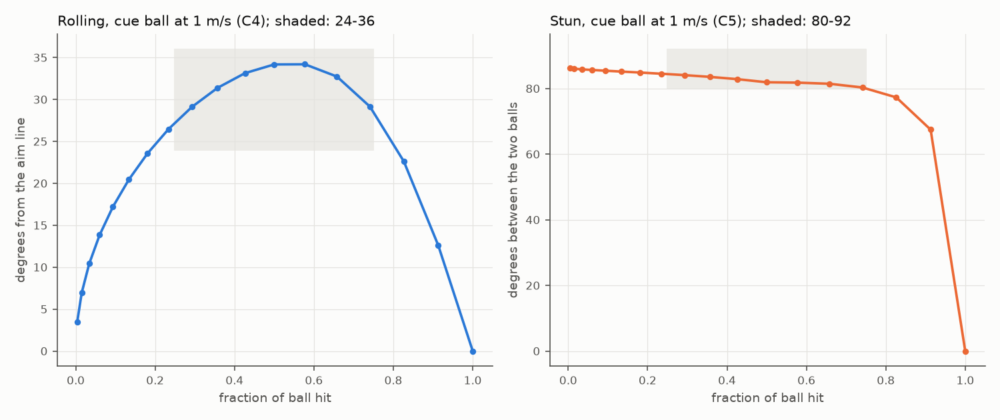
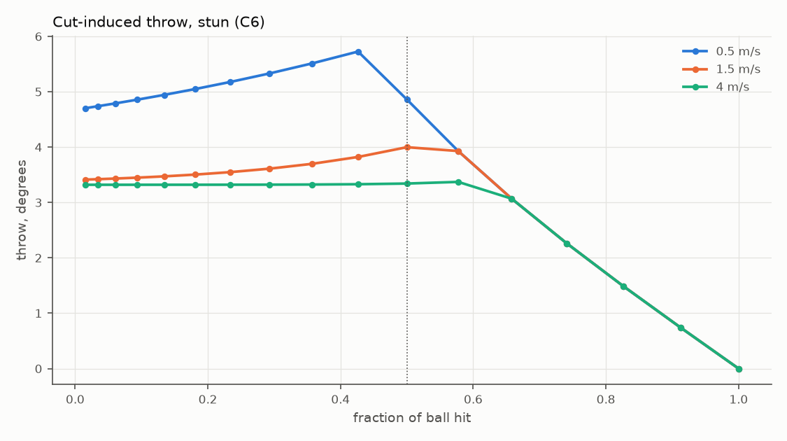
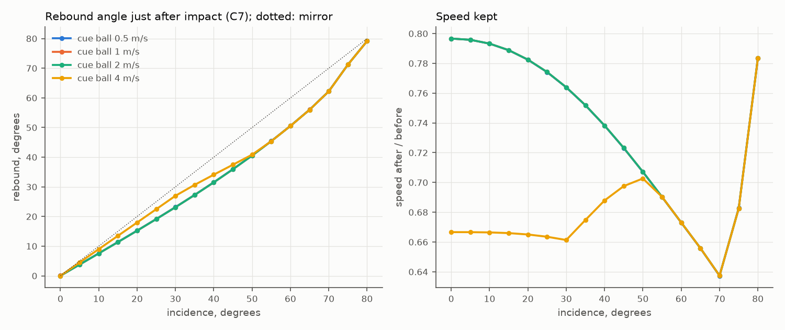
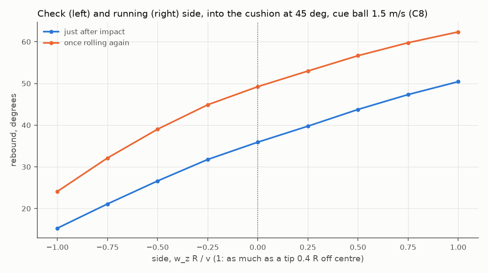
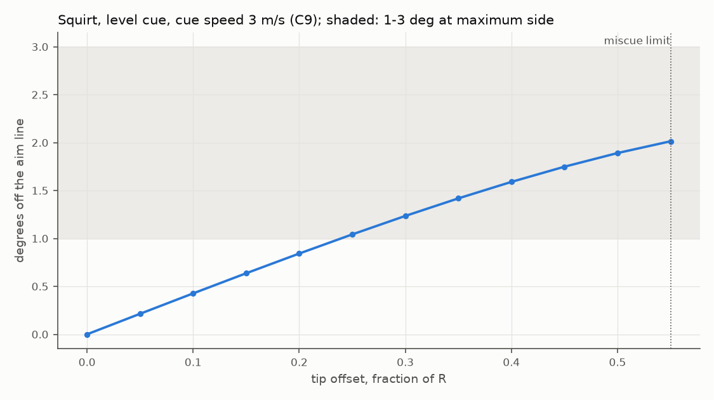
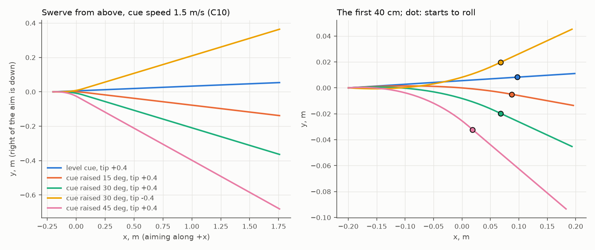
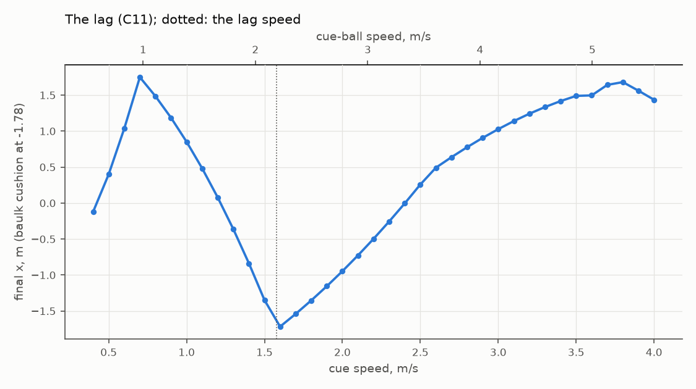
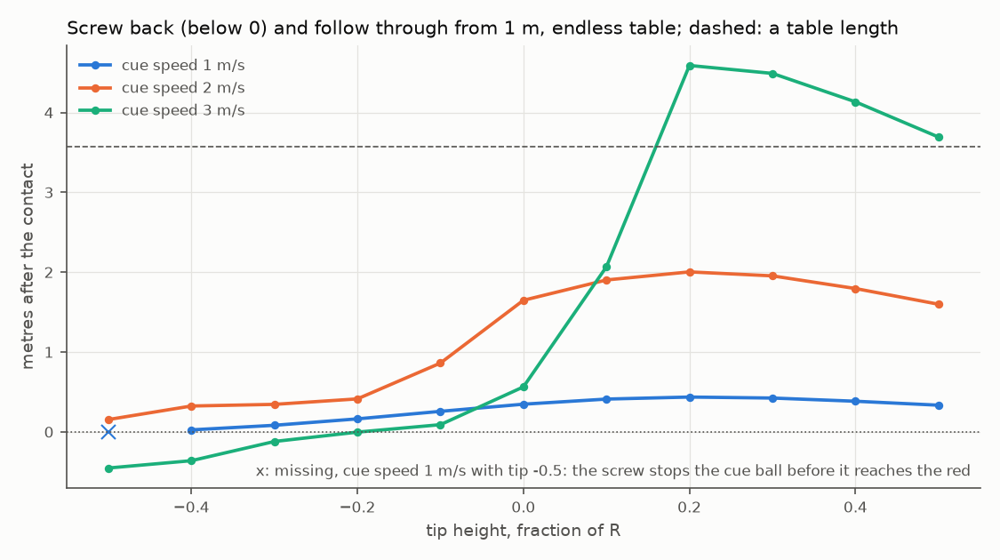
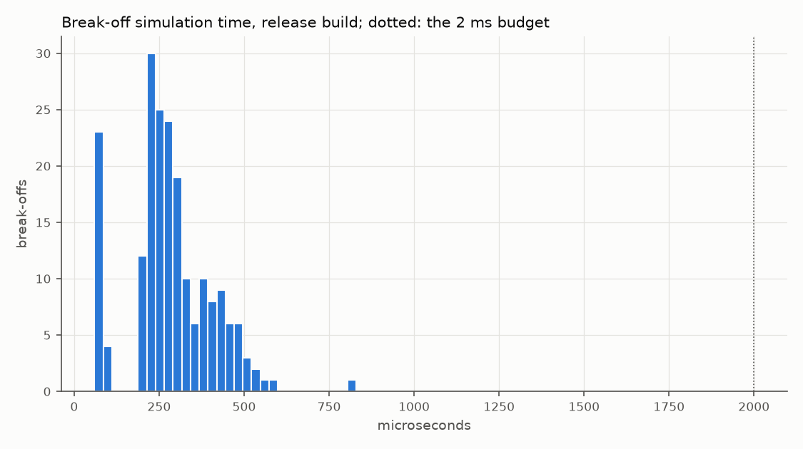

# Calibration report

Physics parameters `aa56554cccd79697`, table outline `5b1972fc1db4890b`, core 0.1.0, release build, from `calibration-data`.

## In plain words

Speeds are the cue ball's speed as it leaves the tip unless a figure says cue speed (how fast the cue is moving). A centre-ball hit sends the cue ball off 1.39 times as fast as the cue; with the tip 0.5 off centre (above, below or to one side) it leaves only 67% as fast as that for the same cue speed. Tip positions are fractions of the ball's radius from its centre: 0.5 is half-way to the edge, just inside the miscue limit of 0.55. Distances between two balls are from centre to centre, and the table is 3.57 m long.

- **Pace.** A centre-ball cue ball left to run: at 1 m/s it runs 3.0 m (84% of the table's length); at 2 m/s it would run 12.0 m on an endless table (3.4 table lengths); at 3 m/s it would run 27.1 m on an endless table (7.6 table lengths).
- **Stun.** A cue ball arriving full-ball at 2 m/s with no spin stops almost dead: it keeps 3.0% of its speed and creeps on 1.1 cm. Striking a third of the way from centre to the bottom of the cue ball (tip -0.33), it stuns from 50 cm when it leaves at 1.83 m/s (it then creeps on 0.4 cm) and from 1 m at 2.66 m/s: from further away you hit harder, because the cloth rubs the backspin off on the way. From 50 cm, hit a tenth harder (2.01 m/s) and it comes back 0.6 cm; a tenth softer (1.65 m/s) and it runs on 5.9 cm. Centre ball from 50 cm at 3 m/s is a stun-run-through: the cue ball arrives still sliding and runs on 25 cm.
- **Screw needs pace.** The cloth takes backspin off quickly. Striking 0.5 below centre, from 50 cm at 2 m/s it comes back 33 cm, at 3 m/s it comes back 2.7 m and at 4 m/s it would come back 6.2 m on an endless table; from 1 m at 2 m/s it runs on 19 cm, at 3 m/s it comes back 92 cm and at 4 m/s it would come back 4.1 m on an endless table. At 2 m/s from 1 m the backspin is gone before the cue ball arrives, so it runs on.
- **Follow.** Striking 0.5 above centre, from 1 m at 2 m/s it follows through 1.9 m and at 3 m/s it would follow through 4.3 m on an endless table. A cue ball already rolling when it hits a ball full keeps 27% of its speed, close to the textbook 2/7 (29%).
- **Cut angles.** A rolling cue ball arriving at 1 m/s and cut between a quarter and three-quarter ball comes off 29-34 degrees from the aim line (the 30-degree rule). Stunned, the two balls part at 80-84 degrees, a little under 90 because the balls are not perfectly elastic and the friction between them drags the object ball along.
- **Throw.** On a half-ball cut, friction between the balls drags the object ball a little the way the cue ball is going, so it goes fuller than the line through the two centres: 4.9 degrees with a stunned cue ball arriving at 0.45 m/s, 4.2 at 1.34 m/s and 3.4 at 3.13 m/s. Over 1 m that is 8.5 cm on the slow cut and 5.9 cm on the firm one, so aim that much thinner. A rolling cue ball throws less: 1.7 degrees at 1.34 m/s.
- **Side and squirt.** Side pushes the cue ball off the aim line, away from the side used: with the most side before a miscue (tip 0.55 off centre) it leaves 2.0 degrees off, 3.5 cm over 1 m.
- **Swerve.** With the cue raised and side, the cue ball first squirts away from the side, then curves back towards it from the moment it is struck while it slides, bending most just before it grips the cloth; once it rolls it runs straight. Raised 30 degrees with the tip 0.4 right of centre, at a cue speed of 1.5 m/s, it squirts 1.4 degrees left, turns 12.9 degrees right over the first 26 cm and then holds its line: 0.1 degrees more over the next 1.7 m, the nap's drift on a slowing ball.
- **Cushions.** A rolling ball arriving straight into a cushion at 1 m/s comes off with 84% of its speed; firm hits lose more, 67% at 4 m/s. (This bounce is set for this table: with the cushion value Mathavan and colleagues fitted, their model, which the game uses, gives 91%; their one set of measurements on a snooker table averaged 82% below 1.5 m/s.) Rolling into a side cushion at 45 degrees with no side, the ball leaves at 40.1 degrees just after the impact, then bends out to 53.4 as it grips the cloth again: that is the line you see. Running side widens both (48.8 and 60.9 degrees, with as much side as a tip 0.4 off centre gives) and check side narrows them (38.5 and 53.1).
- **Cloth speed.** A lag (from the baulk line up to the top cushion and back down to the baulk cushion) needs the cue ball to leave at 2.19 m/s, a cue speed of 1.58 m/s; coming back down from the top cushion to the baulk cushion takes 8.9 seconds.
- **Still starting guesses, for you to judge by feel in M2:** how lively the pocket jaws are (firm balls rattling, slow ones dropping), the nap drift on slow balls with and against the nap, what a miscue does, how much a very hard ball dies on a cushion, and the cloth's overall pace (the one snooker measurement found a slower cloth; tournament tables are heated and faster, so this sits between the two).

## Results against the targets

What this report measured itself, from `ofs_sim_cli calibrate` and its own shots. The calibration suite (`ofs_calibration_tests`, run by the gate) checks the same targets with the exact tolerances in `docs/calibration/targets.md`. "Table's value" means the number is off its published target because of a value set for this table, by the owner's feel or from filmed shots, and inside the band the suite holds the table to; the published target is shown beside it.

| # | What | Measured | Target | Verdict |
| --- | --- | --- | --- | --- |
| C1 | Centre ball, no spin: slides, then rolls | at 2 m/s rolls after 0.4710 m at 1.4286 m/s | 12 v^2 / (49 mu_s g) = 0.4710 m at 5/7 v = 1.4286 m/s (TP 4.1), 1e-6 relative | met |
| C2 | Full-ball stun | cue ball keeps 3.00% of its speed | (1-e)/2 = 3.00%, within 0.2% of the speed | met |
| C3 | Full-ball, rolling | follows at 0.267 of its speed | (5/7)(1-e)/2 + 2/7 = 0.307, less up to 0.061 for topspin friction (TP A.14) | met |
| C4 | Rolling cut, 1/4 to 3/4 ball, cue ball at 1 m/s | 29.1-34.2 deg off the aim line | 30-degree rule, inside 24-36 | met |
| C5 | Stun cut, 1/4 to 3/4 ball, cue ball at 1 m/s | 80.3-84.1 deg between the balls | 90-degree rule less restitution and throw: 80-92 | met |
| C6 | Half-ball stun throw at 0.447 / 1.341 / 3.129 m/s | 4.86 / 4.16 / 3.39 deg | Alciatore 4.5 / 4.1 / 3.45, Jewett 6 / 4.1 / 3.45 (+- 0.75); slow above fast by 0.25 | met |
| C7 | Cushion rebound, rolling, no side, 0.5-4 m/s, 0-80 deg | worst 0.05 deg and 0.05% of the speed off the fine-step Mathavan solution over 36 cases; straight in at 1 m/s the ball keeps 84.0% of its speed | 1 deg, 2% of the model at the table's `cushion_restitution` 0.9 (the suite also checks side, stun and screw); with the paper's 0.98 the ball keeps 91.1%, so this is -7.7% | table's value |
| C8 | Running and check side, into the cushion at 45 deg at 1.5 m/s | check 38.5 < none 40.1 < running 48.8 deg | angles ordered check < plain < running (Mathavan Fig. 8) | met |
| C9 | Squirt at maximum side (tip 0.55) | 2.01 deg | 1-3 deg | met |
| C10 | Swerve, cue raised 15-45 deg with side | while sliding pulled at 2.080 m/s^2 in a direction fixed to 0.00 deg, turning towards the side; once rolling at most 0.06 deg more | TP A.4 parabola: mu_s g = 2.080 m/s^2 in one direction (0.5%, 0.2 deg); straight once rolling apart from the nap | met |
| C11 | Lag: baulk line to the top cushion and back to baulk | cue ball 2.19 m/s; back down from the top cushion in 8.9 s, effective slope 0.0091 | 1.55-2.32 m/s (TP B.6 for slopes 0.0055-0.0105, +-5%); slope 0.0055-0.0105 | met |
| C12-C14 | Energy, determinism, robustness | not measured by this report | ofs_calibration_tests and `ofs_sim_cli fuzz` in the gate | - |

## What changed

What changed from the starting values: M1's tuning to the published sources, then the owner's feel sessions, each with its source in `core/data/table_params.json`:

- Ball-ball friction (`ball_friction_a` 0.009951 to 0.058, `ball_friction_b` 0.108 to 0.092, `ball_friction_c` 1.088 to 2.73): refitted by least squares to the published half-ball stun throw (Alciatore, Billiards Digest Sept 2006; Jewett 1995). The old fit threw 1.7 degrees on a firm cut against 3.45 measured.
- Sliding friction and ball mass (`slide_friction` 0.2 to 0.212, `ball_mass_kg` 0.141 to 0.1406): Mathavan, Jackson & Parkin's measurements on a snooker table and ball (Am. J. Phys. 2009; Proc. IMechE 2010), the same source as the cushion model.
- Rolling resistance (`roll_friction` 0.008 to 0.01): the fast end of the snooker evidence that the lag target allows (Mathavan measured 0.0127 on an unheated lab table).
- Cue end mass (`cue_end_mass_kg` 0.0075 to 0.0047): pooltool's snooker cue (ball mass / 30): squirt at maximum side drops from 3.05 to 2.0 degrees, inside C9's 1-3.
- Cushion restitution on hard hits (`cushion_restitution_slope_per_m_s` 0.0 to 0.16, `cushion_restitution_min` new, 0.7): the slope is a least-squares fit to Mathavan's measured rebounds above 2.5 m/s (Proc. IMechE 2010, Fig. 7b); the floor is Alciatore's typical rail restitution (TP B.6).
- The cloth's pace, by the owner's feel (`roll_friction` 0.01 to 0.015): KaiC's feel sessions on the iPhone, 2026-11-13 to 15, tuned live over the phone link. Slower than the published fast-cloth range the lag target (C11) was built from, and a little slower than the one snooker measurement (0.0127); C11 now holds the lag to his table and shows the published range beside it.
- The cushions' bounce, by the owner's feel (`cushion_restitution` 0.98 to 0.85): the same sessions. Mathavan, Jackson & Parkin fitted 0.98 to their measured rebounds; with 0.85 a ball rolling straight in keeps 80% of its speed instead of 91%, and hard hits reach the 0.7 floor at 3.4 m/s into the cushion instead of 4.25. C7 and C8 check the model at his value; the paper's rebounds stay in the cushion reference and are checked with the paper's value.
- The hardest shot, by the owner's feel (`max_cue_speed_m_s` 10.0 to 6.5): KaiC's session of 2026-11-15: full-power screw and follow carried almost twice the table. 10 m/s was a guess; at 6.5 a full screw from 0.3 m comes back about one and a half lengths.
- The pocket jaws, by the owner's feel (`jaw_restitution` 0.8 to 0.75, `jaw_friction` 0.14 to 0.08): the same session: pots at tight angles were too hard. Both were starting guesses; the lower grip does most of the work, letting a ball that glances the near jaw slide in.
- The cushion's grip on side (`cushion_side_grip` new, 4.0): the same session: side did too little off a cushion (the shot he was after, Selby's blue from the 2014 World final, was misread at the time; the next entry has it as filmed). The paper's one cushion friction was fitted to balls without side and runs out of grip with it. The friction along the cushion is now this many times the friction up its face (1 is the paper's cushion): a third, two thirds and all of the side straight in land 1, 2 and 3 diamonds along, the players' rule, where they gave 1.0, 1.7 and 1.75.
- The cloth's pace and the cushions' bounce, from filmed shots (`roll_friction` 0.015 to 0.009, `cushion_restitution` 0.85 to 0.9): KaiC sent the broadcast of Selby's blue (2014 World final) and a reel of ten cannons. Nine were tracked frame by frame and fitted (positions/selby_blue.json and film_*.json): on these values every cushion is met within 8 cm and 0.1 s and every cannon made. The rolling legs give the cloth directly (0.0075 to 0.012). The feel values of 2026-11-13 to 15 were set while the cue was half as strong again; the cushion was close, the cloth far too slow (Selby's cue ball stopped 0.3 m short at full power). C11 checks the published lag range again.
- The cushion's grip on side, back to the paper's (`cushion_side_grip` 4.0 to 1.0): the same films: Trump's two screw shots with side play within 2 cm and 0.05 s on the paper's one cushion friction and cannot be played at 2 or 4. The pool rule that set 4 does not hold on a snooker cushion.

## Charts

Each chart says what it shows and whether it meets its target from spec 7.11. "For review" means the target is the owner's feel rather than a number this report can check.

| Target | Chart | Verdict |
| --- | --- | --- |
| C4, C5 | [Cue ball deflection against cut, rolling and stunned](#c4-c5-cue-ball-deflection-against-cut-rolling-and-stunned) | met |
| C6 | [Cut-induced throw against cut](#c6-cut-induced-throw-against-cut) | met |
| C7 | [Cushion rebound angle and speed against incidence](#c7-cushion-rebound-angle-and-speed-against-incidence) | table's value |
| C8 | [Running and check side off a cushion](#c8-running-and-check-side-off-a-cushion) | met |
| C9 | [Squirt against side](#c9-squirt-against-side) | met |
| C10 | [Swerve paths with an elevated cue and side](#c10-swerve-paths-with-an-elevated-cue-and-side) | met |
| C11 | [The lag: cue speed to reach the top cushion and back to baulk](#c11-the-lag-cue-speed-to-reach-the-top-cushion-and-back-to-baulk) | met |
| 7.12 | [Screw-back and follow distance against tip height](#712-screw-back-and-follow-distance-against-tip-height) | for review |
| 7.13 | [Simulation time of break-offs](#713-simulation-time-of-break-offs) | met |

### C4, C5: Cue ball deflection against cut, rolling and stunned

How far the cue ball turns from its aim line after hitting a red, against how full the hit is (1 is full-ball, 0 the thinnest), for a rolling cue ball and a stunned one, the cue ball at 1 m/s. A rolling cue ball cut between a quarter and three-quarter ball deflects 29.1 to 34.2 degrees from its aim line, inside the 30 degree rule's 24 to 36 (C4). Stunned, the two balls part at 80.3 to 84.1 degrees, inside the 90 degree rule's 80 to 92 (C5).

Setup: At 1 m/s. separation_deg is between the two balls' directions just after impact; cue_deflection_deg is the cue ball's direction from the aim line once it rolls again.

### C6: Cut-induced throw against cut

How far friction between the balls pushes the object ball off the line of centres, against how full the hit is, for a stunned cue ball arriving at 0.5, 1.5 and 4 m/s. At a half-ball hit the object ball is thrown 4.9 degrees with the cue ball at 0.5 m/s, 4.0 degrees with the cue ball at 1.5 m/s, 3.3 degrees with the cue ball at 4 m/s. Slower shots should throw more (they do) and stay within the few degrees published measurements show, 1 to 6 here (they do) (C6).

Setup: Stun shots (no spin at contact): throw is the angle between the object ball's direction and the line of centres at impact.

### C7: Cushion rebound angle and speed against incidence

The angle a plain rolling cue ball comes off the side cushion at, against the angle it goes in at, at 0.5, 1, 2 and 4 m/s, and how much of its speed it keeps. Rebound angles run 0.0 to 80.5 degrees and the ball keeps 66.7 to 94.3% of its speed. Up to 2 m/s the speeds give the same angles to within 0.05 degrees, so their lines lie on top of each other; only the firm hit's restitution falls. Against the target (C7): worst 0.05 deg and 0.05% of the speed off the fine-step Mathavan solution over 36 cases; straight in at 1 m/s the ball keeps 84.0% of its speed; the target is 1 deg, 2% of the model at the table's `cushion_restitution` 0.9 (the suite also checks side, stun and screw); with the paper's 0.98 the ball keeps 91.1%, so this is -7.7%.

Setup: A rolling ball without side into the left side cushion. Angles from the cushion normal; rebound_deg just after the impact, rebound_rolling_deg once the ball rolls again.

### C8: Running and check side off a cushion

The rebound angle of a ball rolling into the cushion at 45 degrees at 1.5 m/s with check side (left), none and running side (right). Side 1 is as much as a tip 0.4 R off centre gives. Into the cushion at 45 degrees, running side sends the ball off at 48.8 degrees just after the impact, no side at 40.1 degrees and check side at 38.5 degrees. Once the ball grips the cloth again its path opens out to 60.9, 53.4 and 53.1 degrees. Running side should widen the angle and check side narrow it (it does) (C8).

Setup: side is w_z R / v at the start, positive for running side, negative for check side.

### C9: Squirt against side

How far side pushes the cue ball off the aim line, against how far from centre the tip strikes (a level cue at a cue speed of 3 m/s); past the miscue limit the strike miscues. With the most side before a miscue (0.55 R) the cue ball leaves 2.0 degrees off the aim line, inside the 1 to 3 degree range (C9).

Setup: A level cue at 3 m/s. squirt_deg is signed from the aim line.

### C10: Swerve paths with an elevated cue and side

The cue ball's path seen from above with the cue raised and side applied, aiming up the table at a cue speed of 1.5 m/s; the right-hand panel is the first 40 cm, with a dot where each starts to roll. With a raised cue, 15 deg, tip +0.40 turns 6.0 degrees right over its first 29 cm and 0.0 more in the 1.7 m after it grips; 30 deg, tip +0.40 turns 12.9 degrees right over its first 26 cm and 0.1 more in the 1.7 m after it grips; 30 deg, tip -0.40 turns 12.9 degrees left over its first 26 cm and 0.1 more in the 1.7 m after it grips; 45 deg, tip +0.40 turns 21.6 degrees right over its first 22 cm and 0.1 more in the 1.9 m after it grips. Each curves towards its side while it slides, on a parabola (a fixed pull of 2.08 m/s^2, the cloth's sliding friction), bending most just before it grips, and runs straight once it rolls apart from the nap's slight drift. (C10)

Setup: Aiming along +x at 1.5 m/s from (-0.20, 0.00); positive tip_x is right of centre as the player sees it, which is towards -y. Each path stops at the cue ball's first contact.

### C11: The lag: cue speed to reach the top cushion and back to baulk

Where a centre-ball cue ball stops for each cue speed, played from the baulk line to the top cushion and back. A lag, up to the top cushion and back to baulk, needs a cue speed of 1.58 m/s, sending the cue ball off at 2.19 m/s. Against the target (C11): cue ball 2.19 m/s; back down from the top cushion in 8.9 s, effective slope 0.0091; the target is 1.55-2.32 m/s (TP B.6 for slopes 0.0055-0.0105, +-5%); slope 0.0055-0.0105.

Setup: Centre ball from the middle of the baulk line straight up the table. The lag is the slowest cue speed whose cue ball touches the top cushion and then the baulk cushion.

### 7.12: Screw-back and follow distance against tip height

How far the cue ball screws back or follows through after a full-ball hit on a red 1 m away, against how high or low the tip strikes, at three cue speeds. After a full-ball hit the cue ball travels at a cue speed of 1 m/s from +0.02 m (tip -0.4) to +0.33 m (tip +0.5); at a cue speed of 2 m/s from +0.15 m (tip -0.5) to +1.60 m (tip +0.5); at a cue speed of 3 m/s from -0.45 m (tip -0.5) to +3.69 m (tip +0.5), negative being screw back. At a cue speed of 1 m/s with the tip -0.5 the cue ball never reaches the red, stopping 0.80 m from where it started: the screw slows it too much, so the chart shows that point as missing. The owner judges screw and follow by feel (spec 7.12).

Setup: Full-ball hit on a red 1 m away (centre to centre), simulated by this report on an endless table (the real outline scaled up 20 times), so no cushion is in reach. Distance from the contact to where the cue ball stops, along the aim: negative is screw back. The speeds are cue speeds; the cue ball leaves slower the further the tip is from centre.

### 7.13: Simulation time of break-offs

How long the simulation of each break-off took on this PC. Over 200 break-offs the simulation took a median of 255 us and at most 585 us, within the 2000 us budget (spec 7.13).

Setup: Wall-clock time of simulate() per break-off, measured in a release build; only release timings count against the budget.
